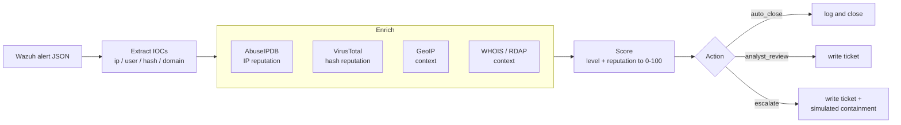

# soc-automation

**An automated alert-handling pipeline for Wazuh: enrich → score → respond. A raw alert becomes an enriched, triaged, ticketed incident in seconds: the ~8-minute manual lookup done automatically, the same way every time.**


This automates, in code, the manual triage I did by hand in my [ir-threat-hunt](https://github.com/manlikefelo/ir-threat-hunt) project. When a Wazuh alert fires, the pipeline pulls out the observables, enriches them (IP reputation, file-hash reputation, GeoIP, WHOIS), scores the alert, and, for high-confidence cases, writes an incident ticket and records the containment it would take. It ships **two ways**: a transparent, unit-tested Python package *and* an equivalent [Shuffle](https://shuffler.io/) SOAR workflow, so you can see both the code-first and the platform approach.

> **Problem:** SOC analysts burn ~8 minutes of rote lookups per alert (AbuseIPDB, VirusTotal, GeoIP, WHOIS, write-up), inconsistently, on hundreds of alerts a day.
> **Approach:** a scored pipeline that enriches every alert automatically and only surfaces the ones a human needs to see.
> **Result:** ~8 min → seconds, identical every time, with an auto-written ticket and simulated containment for escalations.

---

## Architecture



**Offline-first by design.** The lab's alerts use private IPs (`10.10.10.0/24`) that public reputation services can't score, and the tests must run with no keys and no network. So a source is only queried live when its key is set **and** offline mode is off; otherwise the pipeline runs entirely on cached/documented data. Private IPs are short-circuited before any call.

## Quick start

```bash
pip install -e .
# runs fully offline by default:
soc-triage run samples/alerts/dcsync.json --tickets tickets/
```

```
[ESCALATE] risk 56/100 - DCSync - Directory Replication Rights Exercised by a Non-DC (rule 100012)
    ip:10.10.10.40  [abuseipdb] private/lab IP - no public reputation (context)
    ip:10.10.10.40  [geoip] private/lab IP - no geolocation (context)
    ticket: tickets/1710000001.100200-100012.md
    [SIMULATED] block source IP 10.10.10.40 at the perimeter firewall
    [SIMULATED] isolate host DC01 via EDR/Wazuh active-response
    [SIMULATED] disable account b.otieno pending investigation
    [SIMULATED] rotate krbtgt password twice (assume domain compromise)
```

`soc-triage run` takes a single alert or a directory; `--json` gives machine output; exit code is **1** when any alert escalates (a pager signal), **0** otherwise.

### Live enrichment (optional)

```bash
cp .env.example .env      # add your free AbuseIPDB + VirusTotal keys
# set SOC_OFFLINE=0 in .env, then:
soc-triage run samples/alerts/external_bruteforce.json
```

The `external_bruteforce.json` sample uses a public IP + the EICAR test hash so live enrichment returns real results.

## Scoring model (transparent on purpose)

```
base   = wazuh_level / 15 * 70            # severity drives the floor
boost  = up to +30 from the top malicious enrichment signal
score  = min(100, base + boost)

score >= 70  OR  level >= 12                 -> ESCALATE       (+ ticket + simulated containment)
40 <= score < 70  OR  any malicious signal   -> ANALYST_REVIEW (+ ticket)
otherwise                                    -> AUTO_CLOSE      (log only)
```

A critical rule (level >= 12, e.g. DCSync) escalates on severity alone, reputation can't argue a domain-compromise signal down. See [`src/soc_automation/scoring.py`](src/soc_automation/scoring.py).

## Testing: the QA connection

Every external API is **mocked** (`responses`), so the suite is hermetic: no keys, no network. It asserts both directions (a malicious verdict when the API says so, a clean one when it doesn't) plus rate-limit / server-error handling, caching (only one real call per IOC), private-IP short-circuiting, and offline mode. **54 tests, 96% coverage**, ruff + mypy `--strict` clean, CI on Python 3.11/3.12/3.13.

```bash
pip install -e ".[dev]"
ruff check . && mypy src && pytest --cov=soc_automation --cov-report=term-missing
```

## Layout

```
src/soc_automation/
  models.py            Alert / IOC / Enrichment / Verdict / Response
  extract.py           IOC extraction + public-IP detection
  config.py            offline-first config (.env)
  cache.py             on-disk enrichment cache
  enrichment/          abuseipdb / virustotal / geoip / whois + base class
  scoring.py           the triage scoring engine
  response.py          ticket generation + simulated containment
  pipeline.py          alert -> enrich -> score -> respond
  cli.py               soc-triage CLI
shuffle/               the equivalent Shuffle SOAR workflow (JSON)
samples/alerts/        sample Wazuh alerts (AD + web + external)
docs/                  metrics.md / shuffle-setup.md / reviewer-path.md
```

## Showcase

- **A raw alert vs. the auto-enriched, scored, ticketed output**: the added context makes the value obvious. See the sample run above and a generated ticket under `tickets/`.
- **The time-saved metric**: [`docs/metrics.md`](docs/metrics.md): ~8 min → seconds.
- **The mocked pytest suite**: testing my own SOAR logic ([`tests/test_enrichment.py`](tests/test_enrichment.py)) is the rare, credible detail; it's the QA background applied to automation.
- **Both approaches:** code-first Python + a Shuffle workflow ([`docs/shuffle-setup.md`](docs/shuffle-setup.md)).

## How it fits the portfolio

- Automates the manual triage from **[ir-threat-hunt](https://github.com/manlikefelo/ir-threat-hunt)** (P4).
- Consumes alerts from the detections in **[detection-engineering](https://github.com/manlikefelo/detection-engineering)** (P2) / **[detection-as-code](https://github.com/manlikefelo/detection-as-code)** (P5).
- Part of the pinned **[cybersecurity-portfolio](https://github.com/manlikefelo/cybersecurity-portfolio)** meta-repo.

New here? Start with [docs/reviewer-path.md](docs/reviewer-path.md).

## Constraints

Free tiers only (AbuseIPDB, VirusTotal public API, ip-api.com, RDAP, Shuffle open-source). Secrets via `.env`, never committed.

## License

MIT © 2026 Felix Githure
